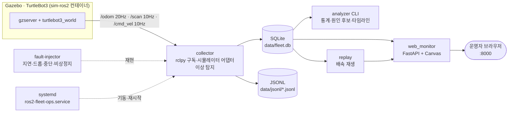

# ros2-fleet-ops

ROS 2 로봇의 **상태·센서·주행 기록을 수집하고, 이상을 탐지하고, 다시 재생해서 원인을 좁히는** 운영 파이프라인입니다.
`/odom`, `/scan`, `/cmd_vel`을 SQLite + JSONL로 적재하고, 규칙 기반 이상 탐지로 알람을 남기며, FastAPI 웹 대시보드에서 궤적·주기(Hz)·알람·Replay를 확인합니다.

네이버랩스 **Robot Software Engineer (Platform & Operations)** (공고 `30005752`)의 *What You'll Do* / *Required Skills*에 대응하도록 만든 개인 프로젝트입니다.
ROS 2 Humble + Gazebo(TurtleBot3)에서 실제로 도는 구성을 제공하면서, **ROS 2가 없는 환경(GitHub Actions, 일반 Python)에서도 시뮬레이터 어댑터 모드로 수집 → 저장 → 탐지 → 분석 → Replay 전체가 동작**하도록 두 가지 소스를 같은 파이프라인에 연결했습니다.

```
로봇(Gazebo TurtleBot3 또는 시뮬레이터)
      │  /odom  /scan  /cmd_vel
      ▼
collector ── SQLite(data/fleet.db) + JSONL(data/jsonl/*.jsonl)
      │            │
      │            ├── analyzer  : 토픽 통계·알람 타임라인·원인 후보 리포트
      │            └── replay    : 주행 기록 시간순 재생
      ▼
web_monitor (FastAPI + Canvas) ── /api/robots, /api/alarms, /api/replay
```



## 1. 무엇이 들어 있나

| 구성 | 파일 | 역할 |
| --- | --- | --- |
| 수집기 | `collector/collector.py` | rclpy 구독(ROS 2) / 시뮬레이터 어댑터, SQLite·JSONL 적재, heartbeat |
| 저장소 | `collector/storage.py` | runs / samples / alarms 스키마, 조회·집계 API |
| 이상 탐지 | `collector/anomaly.py` | 토픽 정지·복구, 결번, 수신 간격 급증, 지연 예산 초과, 주기 저하, 비상정지 추정 |
| 사후 분석 | `collector/analyzer.py` | 실제 샘플 타임스탬프로 통계를 계산하고 원인 후보·조치·타임라인 출력 |
| 재생 | `collector/replay.py` | 기록을 원래 시간 간격(또는 배속)으로 재생, 진행률·프레임 API |
| 웹 관제 | `web_monitor/main.py`, `static/index.html` | 상태·주행 기록·알람 조회, 2D 궤적, Replay 실행 |
| 장애 주입 | `scripts/inject_fault.py` | 지연·드롭·중단·비상정지 재현, 기대 알람 검증(`--expect`) |
| 배포 | `docker-compose.yml`, `*/Dockerfile`, `deploy/ros2-fleet-ops.service` | Gazebo + collector + monitor, healthcheck, systemd |
| 테스트 | `tests/` | 수집·저장·탐지·분석·재생·API·장애주입·구성 파일 검증 |

```
collector/        # 수집·저장·탐지·분석·재생 (핵심 로직, ROS 2 없이 테스트 가능)
web_monitor/      # FastAPI API + 정적 대시보드
scripts/          # inject_fault.py (시뮬레이터 / ROS 2 모드)
sim-ros2/         # Gazebo + TurtleBot3 컨테이너
config/           # 토픽별 기대 주기·지연·정지 임계값 YAML
deploy/           # systemd 유닛
tests/            # pytest 87건
docs/runbook.md   # 장애 대응 런북
```

## 2. 공고 요건과 구현 대응

### What You'll Do

| 공고 업무 | 이 프로젝트에서의 구현 |
| --- | --- |
| Linux, ROS 2 기반 로봇 SW 플랫폼·운영 환경 구축 | `docker-compose.yml`(sim-ros2 / collector / web_monitor), ROS 2 Humble 기반 `collector/Dockerfile`, `deploy/ros2-fleet-ops.service`(systemd), 서비스별 healthcheck |
| 로봇 상태·센서 데이터·주행 기록 수집/재생 파이프라인 | `collector.py`(rclpy 구독, 세 토픽), `storage.py`(SQLite+JSONL), `replay.py`(시간순 재생·배속) |
| 웹 기반 관제·모니터링 도구 | `web_monitor/main.py` REST API + `static/index.html` Canvas 대시보드(궤적, 측정 Hz, 알람, Replay) |
| Docker 기반 패키징, 배포, CI/CD | Dockerfile 3종, compose healthcheck·의존성 조건, `.github/workflows/ci.yml`(테스트 + `docker compose config` + 장애 주입 스모크) |
| 시뮬레이터 연동 및 통합 테스트 자동화 | Gazebo TurtleBot3 컨테이너 + 동일 파이프라인, 시뮬레이터 어댑터로 CI에서 end-to-end 검증, pytest 87건 |
| 장애 원인 분석 및 재발 방지 | `analyzer.py`(근거·조치·타임라인), `inject_fault.py`로 재현, `docs/runbook.md` 절차 |
| 외부 관제 플랫폼·AI 서비스와의 API 연동 | JSON REST API(`/api/robots`, `/api/runs`, `/api/alarms`, `/api/replay`), JSONL 원본 보관 |

### Required Skills

| 요건 | 구현 |
| --- | --- |
| Linux 프로세스·네트워크·systemd 운영 | systemd 유닛(재시작 정책·`ExecStartPre` compose 검증), heartbeat 파일 기반 healthcheck, SIGTERM 정상 종료 처리 |
| Python 기반 개발 | 전체 (표준 라이브러리 중심 코어 + FastAPI) |
| Docker 기반 서비스 구성·배포 | compose 프로필(`tools`로 장애 주입 분리), 볼륨(`./data:/data`), healthcheck·`depends_on` 조건 |
| ROS 2 / 분산 메시징 지식 | rclpy 노드, `SensorDataQoS`, `ROS_DOMAIN_ID`, Gazebo `/clock` 사용 시 `use_sim_time` 처리 |
| 로그·측정 데이터 기반 원인 분석 | 수신/발행 타임스탬프 차이, seq 결번, 수신 간격, 측정 주기로 통계 산출 후 원인 후보 제시 |

## 3. 이상 탐지 규칙

임계값은 `config/collector.yaml`에서 토픽별로 조정합니다. 모든 값은 **기대값(설정)** 이며, 리포트의 Hz·ms는 **실제 샘플 타임스탬프로 계산한 값**입니다.

| 알람 | 의미 | 판정 근거 |
| --- | --- | --- |
| `topic_silent` | 발행 노드 정지·통신 단절 | `silence_factor / expected_hz` 초과 (최소 0.5s), 2배 초과 시 critical |
| `topic_recovered` | 수신 재개 | 정지 알람 이후 첫 샘플 |
| `topic_drop` | 메시지 결번 | 발행 seq 연속성 위반 (시뮬레이터 모드에서 검증) |
| `gap_spike` | 순간 지연 | 수신 간격 > 기대 주기 × 2.5 (정지 판정 전) |
| `latency_high` | 지연 예산 초과 | `recv_ts - source_ts > max_latency_s`, 2배 초과 시 critical |
| `rate_low` | 발행 주기 저하 | 최근 구간 측정 주기 < 기대 × 0.5 |
| `estop_command` | 비상정지 추정 | `cmd_vel`이 0인데 `odom` 속도 > 0.02 m/s |

알람은 `(토픽, 종류)`별 쿨다운을 두어 한 번의 장애가 수백 건으로 늘어나지 않게 합니다.

## 4. 빠른 시작 A — ROS 2 없이 (시뮬레이터 어댑터)

```bash
python3 -m venv .venv && source .venv/bin/activate
pip install -r requirements-dev.txt

# 1) 정상 주행 30초 수집
python -m collector.collector --mode sim --duration 30 --db data/fleet.db --jsonl-dir data/jsonl

# 2) 지연·드롭·중단·비상정지를 넣은 장애 시나리오 + 즉시 분석
python scripts/inject_fault.py \
  --faults latency,drop,silence,estop \
  --latency-ms 350 --latency-topic /scan \
  --drop-every 6 --drop-topic /odom \
  --silence-at 12 --silence-for 4 \
  --estop-at 22 --estop-for 3 \
  --duration 30 --analyze

# 3) 사후 분석 (최신 run)
python -m collector.analyzer --latest

# 4) 웹 대시보드
uvicorn web_monitor.main:app --host 0.0.0.0 --port 8000
# http://localhost:8000
```

```powershell
# Windows PowerShell (ROS 2 없이 시뮬레이터 모드만 사용할 때)
py -m venv .venv
.\.venv\Scripts\Activate.ps1
py -m pip install -r requirements-dev.txt
py -m collector.collector --mode sim --duration 30
```

`--mode auto`(기본)는 `rclpy`가 import되면 ROS 2, 아니면 시뮬레이터로 자동 선택합니다.
시뮬레이터는 TurtleBot3 burger의 발행 주기(odom 20 Hz, scan 10 Hz, cmd_vel 10 Hz)와 사각 순찰 경로, 벽까지의 거리를 계산한 36빔 스캔을 생성합니다.

이 작업 환경에서 만든 데모 run 2건(정상 20초, 장애 30초)이 `data/demo.db`에 남아 있습니다. 바로 대시보드를 띄워 보려면:

```bash
FLEET_DB=data/demo.db uvicorn web_monitor.main:app --port 8000
```

## 5. 빠른 시작 B — Docker Compose + Gazebo

```bash
docker compose up --build          # sim-ros2 → collector → web_monitor (healthcheck 통과 후 기동)
docker compose ps                  # 세 서비스 healthy 확인
open http://localhost:8000         # 대시보드
docker compose run --rm fault-injector   # 장애 시나리오를 같은 DB에 생성
docker compose down
```

* Gazebo 컨테이너와 collector는 DDS 디스커버리를 위해 `network_mode: host`(Linux)를 사용합니다. Docker Desktop(macOS/Windows)에서는 호스트 네트워크가 동작하지 않으므로 위의 시뮬레이터 모드를 사용하세요.
* Gazebo의 `/clock`을 쓰기 때문에 collector는 `--use-sim-time`으로 실행됩니다(헤더 스탬프와 수신 시각의 시간 도메인 일치).
* 헤드리스 기본값은 `GAZEBO_GUI=false`이고, GUI가 필요하면 `GAZEBO_GUI=true docker compose up`으로 실행합니다.

## 6. 장애 주입 시나리오

| 장애 | 시뮬레이터 명령 | ROS 2 모드 | 기대 알람 |
| --- | --- | --- | --- |
| 지연 | `--faults latency --latency-ms 350 --latency-topic /scan` | `--mode ros2 --fault delay --delay-ms 350` (relay 노드) | `latency_high` |
| 드롭 | `--faults drop --drop-every 6 --drop-topic /odom` | 수신 측 결번은 seq가 없는 ROS 2에서 `gap_spike`/`rate_low`로 관측 | `topic_drop` |
| 중단 | `--faults silence --silence-at 12 --silence-for 4` | `--mode ros2 --fault silence --target-pid <PID>` (SIGSTOP→SIGCONT) | `topic_silent` → `topic_recovered` |
| 비상정지 | `--faults estop --estop-at 22 --estop-for 3` | `--mode ros2 --fault estop` (zero Twist publish) | `estop_command` |

`--expect latency_high,topic_drop`처럼 기대 알람을 지정하면, 탐지되지 않았을 때 종료 코드 1로 실패합니다(CI 스모크 테스트에서 사용).

## 7. 실제 분석 리포트 (이 환경에서 실행한 결과)

아래는 `--faults latency,drop,silence,estop` 시나리오(30초)를 실행한 뒤 `analyzer`가 출력한 실제 결과입니다.

```
==============================================================================
 ros2-fleet-ops 분석 리포트
==============================================================================
 run       tb3-sim-01-20261125T152750-052505
 로봇       tb3-sim-01 (sim)
 구간       2026-11-25 15:27:49 ~ 2026-11-25 15:28:20  (30.251s)
 샘플       1060건 / 알람 31건
 판정       DEGRADED
 비고       fault-injection: latency 350ms on /scan, drop every 6th /odom message, silence /scan for 4s from 12s, emergency stop 3s from 22s

[토픽 통계]
 토픽             건수     측정Hz       최대간격     p95지연     결번  알람
 /cmd_vel      300     10.0    101.8ms     1.9ms      0  estop_command×1
 /odom         500     16.7    101.8ms     1.9ms     99  topic_drop×15
 /scan         260      8.7   4099.8ms   351.9ms      0  latency_high×13, topic_recovered×1, topic_silent×1

[탐지된 이상]
 1. [warning] latency_high /scan ×13 - 메시지 지연 예산 초과(처리 또는 전송 지연)
    근거: /scan 지연 351ms (예산 300ms)
    조치: 수신 타임스탬프와 발행 타임스탬프 차이를 확인하고, 브리지·릴레이·네트워크 구간을 분리 측정한다.
 2. [warning] topic_drop /odom ×15 - 메시지 드롭(발행 측 큐 또는 수신 버퍼 포화)
    근거: /odom 메시지 1건 결번 (seq 5 → 7)
    조치: QoS depth·DDS 버퍼와 수신 측 처리 시간을 확인한다. 결번이 몰리는 시각의 CPU 사용률을 함께 본다.
 3. [warning] topic_silent /scan ×1 - 해당 토픽의 발행 노드 정지 또는 통신 단절
    근거: /scan 0.5s 동안 수신 없음 (기준 0.5s)
    조치: 노드 프로세스 상태(systemd/ros2 node list)와 네트워크 링크를 확인하고, 재시작 후 동일 구간을 Replay로 재검증한다.
 4. [warning] estop_command /cmd_vel ×1 - 비상정지/정지 명령으로 로봇 제어가 끊김
    근거: cmd_vel=0 인데 odom 속도 0.14 m/s - 비상정지/제어 명령 확인 필요
    조치: cmd_vel 발행자(관제·자율주행 노드)와 비상정지 입력을 확인하고, 정지 해제 후 재개 절차를 따른다.
 5. [info] topic_recovered /scan ×1 - 토픽 수신 재개
    근거: /scan 수신 재개 (마지막 수신 후 4.10s)
    조치: 재개 시점 이후 샘플로 정상 주기·지연이 회복됐는지 확인한다.
```

같은 DB의 정상 주행 run은 `판정 HEALTHY`, 알람 0건으로 나옵니다. `/odom` 측정 20.0 Hz, 결번 0건, p95 지연 1.9 ms — 모두 저장된 샘플에서 계산된 값입니다.

## 8. 웹 API

| 메서드 | 경로 | 설명 |
| --- | --- | --- |
| GET | `/api/health` | DB 경로, run 수, collector heartbeat 신선도 |
| GET | `/api/summary` | 로봇 목록 + 최근 알람 (대시보드 첫 화면) |
| GET | `/api/robots` | 로봇별 최근 상태·포즈·토픽 Hz·health(ok/warning/critical/stale/recorded) |
| GET | `/api/robots/{id}/trajectory?run_id=` | `/odom` 궤적(다운샘플 지원) |
| GET | `/api/runs` | 주행 기록 목록(샘플 수·길이·알람 수) |
| GET | `/api/runs/{run_id}` | 해당 run의 토픽 통계·탐지 항목·판정 |
| GET | `/api/alarms?severity=&run_id=` | 알람 조회 |
| POST | `/api/replay` `{run_id, speed}` | Replay 시작 (0.1×~20×) |
| GET | `/api/replay?since=` | 진행률 + 재생된 프레임 |
| POST | `/api/replay/stop` | Replay 정지 |

대시보드(`/`)는 외부 CDN 없이 Canvas로 궤적을 그리고, 2초마다 상태·알람을, Replay 중에는 250ms마다 프레임을 가져옵니다.

## 9. 운영 배포 (systemd)

```bash
sudo cp -r ros2-fleet-ops /opt/ros2-fleet-ops
cd /opt/ros2-fleet-ops && sudo docker compose build      # 최초 1회 (이후 --no-build로 기동)
sudo useradd -r -s /usr/sbin/nologin fleetops
sudo usermod -aG docker fleetops
sudo cp /opt/ros2-fleet-ops/deploy/ros2-fleet-ops.service /etc/systemd/system/
sudo systemctl daemon-reload
sudo systemctl enable --now ros2-fleet-ops
systemctl status ros2-fleet-ops
```

유닛은 시작 전에 `docker compose config -q`로 문법을 검사하고, `Restart=on-failure`로 복구합니다. 로그·장애 대응 절차는 `docs/runbook.md`에 정리했습니다.

## 10. 테스트

```bash
pip install -r requirements-dev.txt
python -m pytest
```

```
87 passed
```

* 저장소: run/sample/alarm 왕복, JSONL 원본, 조회·집계, heartbeat 신선도, 재시작 후 데이터 유지
* 탐지: 정상 스트림 무알람, seq 결번, 지연·쿨다운, 정지→복구, 간격 급증, 주기 저하, 비상정지 추정
* 수집기: 코어 적재, silence tick, run 종료, ROS 메시지 변환(odom/scan/twist, 헤더 스탬프)
* 시뮬레이터: 세 토픽 발행, 궤적 생성, 4종 장애 탐지, 정상 시 무알람, FaultPlan 검증
* 분석: 정상/저하/치명 판정, 통계 계산, 텍스트·마크다운 출력, CLI 옵션
* 재생: 프레임 순서, 배속, 중간 정지, 상태 진행률
* API: health·summary·robots·trajectory·runs·alarms·replay 전 구간, 404/409
* 장애 주입 스크립트: 실제 서브프로세스 실행으로 4종 알람 end-to-end, `--expect` 실패 코드
* 구성 파일: compose 서비스·healthcheck·profile, Dockerfile, systemd 유닛, CI 워크플로우

GitHub Actions(`.github/workflows/ci.yml`)는 Python 3.11/3.12 매트릭스로 테스트를 돌리고, 3.12에서 장애 주입 스모크(4종 알람 검출 단언)와 `docker compose config -q` 검증을 수행합니다.

## 11. 검증 범위 — 실행한 것과 못 한 것

**이 작업 환경에서 실제로 실행해 확인한 것**

* `pytest`: 87 passed (Python 3.12.16)
* 시뮬레이터 모드 수집: 20초 정상 주행 run(샘플 800건), 30초 장애 run(샘플 1,060건) 생성
* 장애 주입 4종(latency/drop/silence/estop) 탐지 및 `--expect` 단언 통과, 종료 코드 0
* 분석 리포트 출력(위 7절) — 모든 Hz·ms·결번 수치는 저장된 샘플에서 계산
* FastAPI 엔드포인트: TestClient로 전 구간 검증(별도 서버 기동 없이)
* `docker-compose.yml`·CI 워크플로우·systemd 유닛: YAML/구조 파싱 테스트로 검증

**아직 실행하지 못한 것(정직하게)**

* `docker compose up`으로 Gazebo(TurtleBot3)를 띄워 collector가 실제 `/odom`을 받는 장면: 이 작업 환경에 Docker와 ROS 2가 없어 **미검증**입니다. Dockerfile/compose/entrypoint는 실제 패키지 이름과 Humble 경로 기준으로 작성했고, CI에서 `config`만 검증합니다. 첫 실행 시 `docker compose logs -f sim-ros2`로 `/odom` 발행을 확인해야 합니다.
* 실제 TurtleBot3 하드웨어, WebRTC 영상 전송, Jetson 보드 연동: 범위 밖입니다.
* ROS 2 모드의 fault relay/estop/SIGSTOP 경로: rclpy가 필요한 코드로, 로컬 단위 테스트 대상에서 제외했습니다(import 가드).

## 12. 한계와 다음 단계

* 탐지는 임계값 기반입니다. 다음 단계로 run별 베이스라인(중앙값·MAD) 자동 산출과 알람 상관 분석을 붙일 수 있습니다.
* 인증이 없는 대시보드입니다. 내부망 또는 리버스 프록시 뒤에 두는 것을 전제로 했습니다.
* 멀티 로봇은 `robot_id` 단위로 저장·조회하지만, 현재 수집기는 로봇 1대당 1프로세스입니다. DDS 토픽 네임스페이스로 확장할 수 있습니다.
* ROS 2 실기에서 장시간 주행을 돌려 임계값을 튜닝하는 것이 다음 검증 과제입니다.

## 13. 참고

* `config/collector.yaml` : 토픽별 기대 주기·지연·정지 계수
* `docs/runbook.md` : 알람별 1차 확인 → 수집 → 분석 → Replay → 재발 방지 절차
* 코드 스타일: 표준 라이브러리 우선, 코어는 ROS 2 import 없이 테스트 가능, 외부 의존은 FastAPI/uvicorn/PyYAML로 제한
